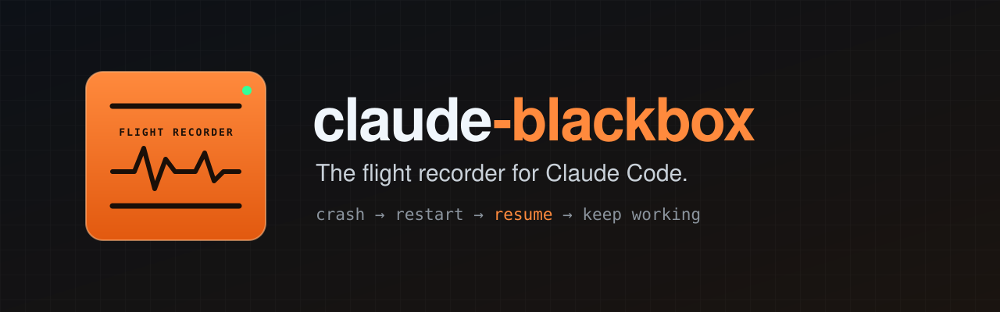
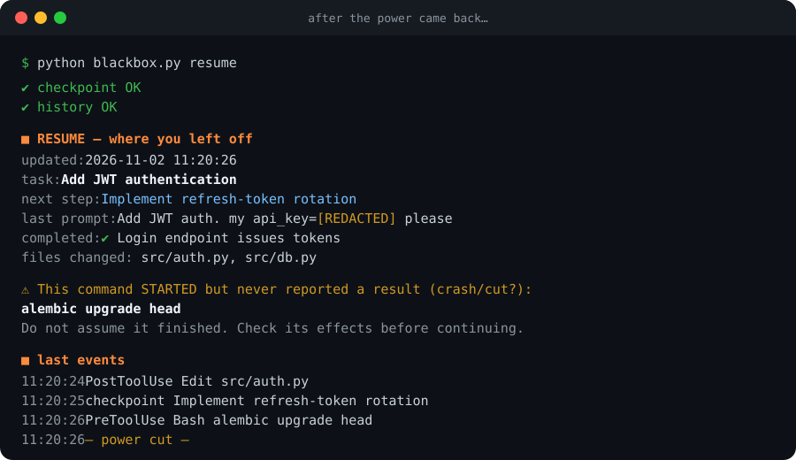

<p align="center">
  
</p>

<p align="center">
  <a href="https://github.com/__USER__/claude-blackbox/stargazers"></a>
  <a href="https://github.com/__USER__/claude-blackbox/releases"></a>
  
  
  
  <a href="LICENSE"></a>
</p>

<p align="center">
  <a href="README.md">English</a> · <b>Español</b>
</p>

---

**Se corta la luz. La PC se reinicia. Se cierra la terminal. Se compacta el contexto.**
Y Claude no tiene idea de qué estaba haciendo hace cinco minutos.

**claude-blackbox** graba todo lo que Claude hace en tu proyecto (cada prompt, comando, archivo editado y decisión)
en una línea de tiempo local y a prueba de cortes. Cuando volvés, Claude **ya sabe dónde quedó**, qué comando se
interrumpió y cuál es el siguiente paso.

<p align="center">
  
</p>

## ✨ Características

- 🛬 **Retoma solo:** en cada sesión nueva, el estado recuperado se inyecta en el contexto de Claude. No hay que volver a explicar nada.
- ⚠️ **Detecta comandos interrumpidos:** marca los comandos que *empezaron* pero nunca *terminaron* (un `alembic upgrade head` durante un apagón…), para que Claude no asuma que salieron bien.
- 📼 **Historial completo:** registro de solo agregado (append-only) con prompts, comandos, archivos editados, checkpoints y decisiones, agrupado por día → sesión.
- 💾 **A prueba de cortes:** escritura atómica con `fsync`, snapshots rotativos y tolerancia a líneas cortadas tras un apagón.
- 🔐 **Tapa secretos:** API keys (`sk-…`, `ghp_…`, `AKIA…`), tokens bearer, `password=…`, claves privadas y credenciales en URLs se enmascaran antes de escribir a disco.
- 🛡️ **Reglas de seguridad:** Claude tiene prohibido ejecutar por su cuenta `git reset --hard`, `git clean -fd`, `docker volume prune` o borrar bases de datos.
- 🪶 **Cero dependencias:** un solo archivo Python. Funciona en Windows, macOS y Linux. 100 % local: nada sale de tu máquina.

## 🚀 Instalación

### Opción A: plugin de Claude Code (recomendada, 2 comandos)

Dentro de Claude Code:

```
/plugin marketplace add __USER__/claude-blackbox
/plugin install claude-blackbox@claude-blackbox
```

Reiniciá Claude Code y listo: los hooks quedan activos y la skill cargada.

### Opción B: skill del proyecto (copiar la carpeta)

<details>
<summary><b>macOS / Linux</b></summary>

```bash
git clone --depth 1 https://github.com/__USER__/claude-blackbox /tmp/claude-blackbox
mkdir -p .claude/skills && cp -r /tmp/claude-blackbox/skills/claude-blackbox .claude/skills/
python3 .claude/skills/claude-blackbox/scripts/blackbox.py install-hooks
```
</details>

<details>
<summary><b>Windows (PowerShell)</b></summary>

```powershell
git clone --depth 1 https://github.com/__USER__/claude-blackbox $env:TEMP\claude-blackbox
New-Item -ItemType Directory -Force .claude\skills | Out-Null
Copy-Item -Recurse $env:TEMP\claude-blackbox\skills\claude-blackbox .claude\skills\
python .claude\skills\claude-blackbox\scripts\blackbox.py install-hooks
```
</details>

`install-hooks` **agrega** los hooks a tu `.claude/settings.json` existente (no lo pisa y antes guarda un `.bak`)
y suma `.blackbox/` al `.gitignore`. Con `--global` graba todos tus proyectos desde `~/.claude/settings.json`.

### Opción C: Claude.ai (web / escritorio)

Descargá `claude-blackbox-skill.zip` de la [última release](https://github.com/__USER__/claude-blackbox/releases/latest)
→ **Configuración → Capacidades → Skills → Subir skill**. (Los hooks son de Claude Code; en Claude.ai tenés el flujo de checkpoints.)

## 🕹️ Uso

Hablale a Claude:

> *"¿Dónde quedamos?"* · *"Retomá la última sesión"* · *"Guardá un checkpoint"* · *"Mostrame la línea de tiempo del proyecto"*

O usá la CLI directamente:

| Comando | Qué hace |
|---|---|
| `blackbox.py resume` | Todo lo necesario tras un corte: estado, comandos interrumpidos, git, últimos eventos |
| `blackbox.py checkpoint --task "…" --done "…" --next "…"` | Guarda el progreso (Claude lo hace solo después de cada paso) |
| `blackbox.py checkpoint --decision "…"` | Registra una decisión importante en `decisions.md` |
| `blackbox.py timeline` | La historia completa: día → sesión → evento |
| `blackbox.py history -n 30` | Últimos eventos |
| `blackbox.py status` · `verify` | Último checkpoint · chequeo de integridad |

## 🧠 Cómo funciona

```
 Hooks de Claude Code                    .blackbox/   (local, en .gitignore)
 ────────────────────                    ──────────────────────────────────
 SessionStart ──────► inyecta estado ───► checkpoints/state.json   ← atómico
 UserPromptSubmit ──► prompts.md          snapshots/state-*.json   ← últimos 50
 PreToolUse (Bash) ─► marca "iniciado"    history/events.jsonl     ← append-only
 PostToolUse ───────► archivos tocados    history/prompts.md
 PreCompact / Stop ─► checkpoint + git    history/commands.log
                                          history/decisions.md
```

Cada evento guarda además el `transcript_path` de Claude Code, así que la conversación completa siempre se puede ubicar.

## ❓ Preguntas frecuentes

**¿Hace más lento a Claude?** No. Cada hook tarda unos milisegundos de escritura local, tiene un timeout de 10 s y nunca bloquea ni rompe tu sesión.

**¿Mis datos se envían a algún lado?** No. Todo son archivos de texto dentro de `.blackbox/` en tu proyecto.

**¿Recupera lo que Claude estaba escribiendo cuando se cortó la luz?** No, y nadie puede: lo que estaba solo en memoria se pierde. Lo que tenés es el último estado guardado, el último checkpoint, el comando interrumpido y la ruta de la transcripción. Normalmente con eso alcanza para seguir.

**La instalé con el proyecto ya empezado. ¿Tengo el historial anterior?** El historial arranca al instalarla. Las transcripciones viejas de Claude Code en `~/.claude/projects/` siguen en disco, y Claude puede leerlas si se lo pedís.

## 🤝 Contribuir

Issues y PRs bienvenidos. Ideas: visor HTML de la línea de tiempo, resúmenes diarios, indexador de transcripciones, panel para VS Code.
Si alguna vez te salvó una sesión, **una ⭐ ayuda a que otros la encuentren.**

## 📄 Licencia

[MIT](LICENSE)
