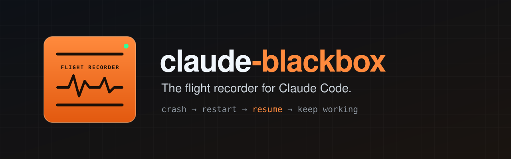
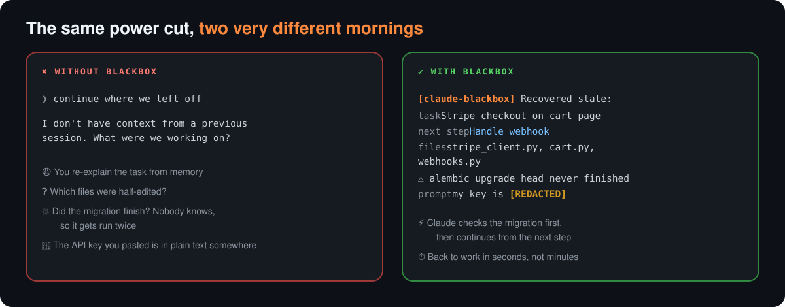
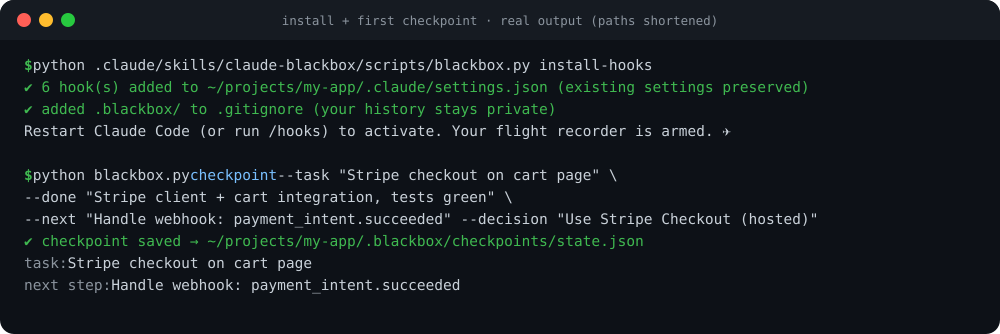
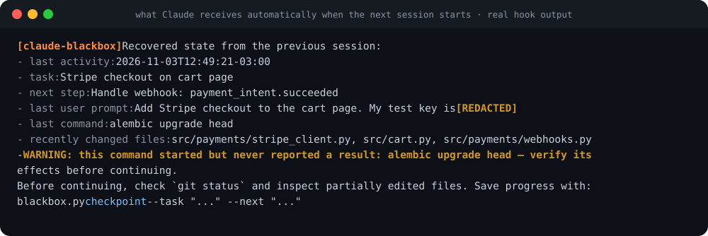
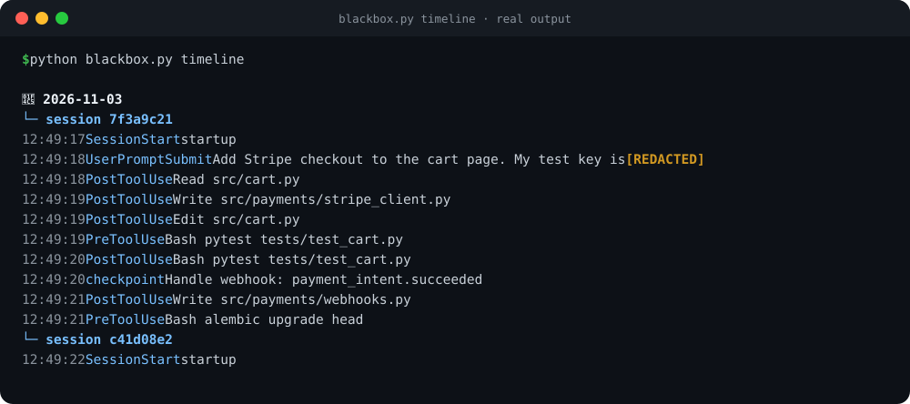
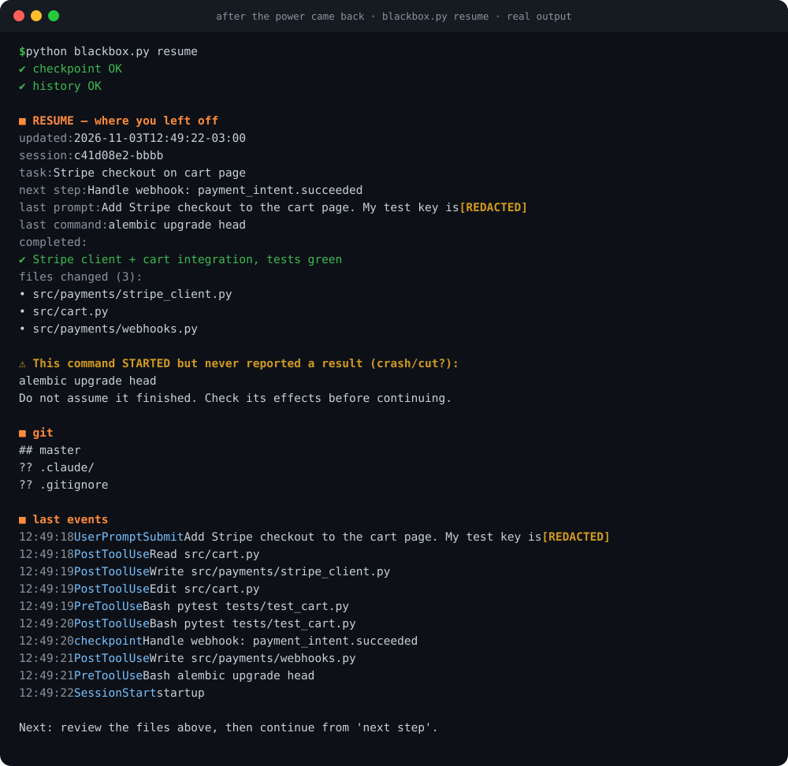
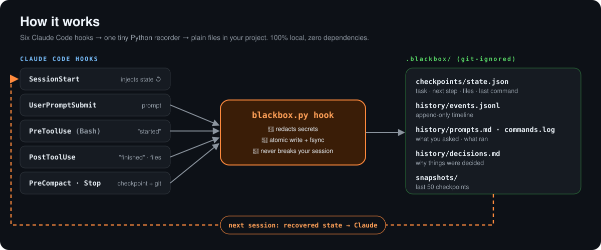

<p align="center">
  
</p>

<p align="center">
  <a href="https://github.com/jorgevb27/claude-blackbox/stargazers"></a>
  <a href="https://github.com/jorgevb27/claude-blackbox/releases/latest"></a>
  <a href="https://github.com/jorgevb27/claude-blackbox/actions/workflows/test.yml"></a>
  
  <a href="LICENSE"></a>
</p>

<p align="center">
  <b>English</b> · <a href="README.es.md">Español</a>
  &nbsp;|&nbsp;
  📘 <a href="docs/MANUAL.en.md"><b>User manual</b></a> · 📗 <a href="docs/MANUAL.es.md">Manual en español</a>
</p>

<p align="center">
  <a href="#-install">Install</a> ·
  <a href="#-see-it-in-action">See it in action</a> ·
  <a href="#-how-it-works">How it works</a> ·
  <a href="#-privacy">Privacy</a> ·
  <a href="#-faq">FAQ</a>
</p>

---

**Your power goes out. Your laptop reboots. The terminal closes. The context gets compacted.**
And Claude has no idea what it was doing five minutes ago. Worse, it may assume that half-finished migration actually ran.

**claude-blackbox** records everything Claude does in your project (prompts, commands, edited files, decisions) into a local, crash-proof timeline.
When the next session starts, Claude **already knows where it left off**, what the next step is, and which command never finished.

<p align="center"></p>

<table>
<tr>
<td align="center" width="25%"><h3>🛬</h3><b>Auto-resume</b><br><sub>state injected into every new session</sub></td>
<td align="center" width="25%"><h3>⚠️</h3><b>Interrupted commands</b><br><sub>"started but never finished" detection</sub></td>
<td align="center" width="25%"><h3>🔐</h3><b>Secret redaction</b><br><sub>keys and tokens masked before disk</sub></td>
<td align="center" width="25%"><h3>🪶</h3><b>Zero dependencies</b><br><sub>one Python file · Win/macOS/Linux</sub></td>
</tr>
</table>

## 🚀 Install

**Claude Code: plugin (recommended, 2 commands)**

```
/plugin marketplace add jorgevb27/claude-blackbox
/plugin install claude-blackbox@claude-blackbox
```

Restart Claude Code. The recorder is armed.

<details>
<summary><b>Or copy it into one project (macOS / Linux / Windows)</b></summary>

```bash
git clone --depth 1 https://github.com/jorgevb27/claude-blackbox /tmp/claude-blackbox
mkdir -p .claude/skills && cp -r /tmp/claude-blackbox/skills/claude-blackbox .claude/skills/
python3 .claude/skills/claude-blackbox/scripts/blackbox.py install-hooks
```

```powershell
git clone --depth 1 https://github.com/jorgevb27/claude-blackbox $env:TEMP\claude-blackbox
New-Item -ItemType Directory -Force .claude\skills | Out-Null
Copy-Item -Recurse $env:TEMP\claude-blackbox\skills\claude-blackbox .claude\skills\
python .claude\skills\claude-blackbox\scripts\blackbox.py install-hooks
```

`install-hooks` **merges** into your existing `.claude/settings.json`: it never overwrites it and writes a `.bak` first.
</details>

**Claude.ai:** download [`claude-blackbox-skill.zip`](https://github.com/jorgevb27/claude-blackbox/releases/latest) → *Settings → Capabilities → Skills → Upload skill*. On Claude.ai you get the checkpoint workflow; automatic recording requires Claude Code hooks.

👉 Every option, step by step: **[User manual](docs/MANUAL.en.md)**

## 🎬 See it in action

<sub>All screenshots below are real output from a test project, with only the paths shortened.</sub>

**1. Install once. Claude saves checkpoints as it works**

<p align="center"></p>

**2. ⚡ Power cut. On the next start, Claude receives this automatically, with no command needed**

<p align="center"></p>

**3. The whole story, any time**

<p align="center"></p>

<details>
<summary><b>See the full <code>resume</code> report</b></summary>
<p align="center"></p>
</details>

## 🧠 How it works

<p align="center"></p>

| Hook | What it records |
|---|---|
| `SessionStart` | session start, and **injects the recovered state into Claude** |
| `UserPromptSubmit` | your prompt (redacted) |
| `PreToolUse` (Bash) | "command started", the key to detecting interrupted commands |
| `PostToolUse` | "command finished", and every file Claude writes or edits |
| `PreCompact` · `Stop` | checkpoint + `git status` + snapshot |

Each write is **atomic with `fsync`**, the last 50 snapshots are kept, and a line cut in half by a power failure is simply skipped.

## 🕹️ Usage

Most of the time you do **nothing**: it records on its own, and Claude saves checkpoints after each step. You can also just ask:

> *"Where did we leave off?"* · *"Save a checkpoint"* · *"Show me the project timeline"* · *"What did we decide about payments?"*

| Command | What it does |
|---|---|
| `blackbox.py resume` | Everything you need after a crash: state, interrupted command, git, last events |
| `blackbox.py checkpoint --task "…" --done "…" --next "…"` | Save progress |
| `blackbox.py checkpoint --decision "…"` | Record a decision in `decisions.md` |
| `blackbox.py timeline` · `history -n 30` | Full story · latest events |
| `blackbox.py status` · `verify` | Last checkpoint · integrity check |
| `blackbox.py install-hooks [--global]` | Add the hooks to this project, or to every project |

## 🔐 Privacy

- **100% local.** Plain files in `.blackbox/` inside your project, and nothing is ever sent anywhere.
- **Never committed.** `.blackbox/` contains its own `.gitignore`, in every install mode.
- **Redacted before writing:** OpenAI/Anthropic `sk-…`, Stripe `sk_live_…`/`whsec_…`, GitHub `ghp_…`, AWS `AKIA…`, Google `AIza…`, Slack `xox…`, JWTs, `Bearer` tokens, `password=`/`token=`/`api_key=` values, private keys, and credentials inside URLs.
- **Not stored:** file contents and command output. Only file *paths* and *commands* are recorded.

## ❓ FAQ

<details><summary><b>Does it slow Claude down?</b></summary>
No. Each hook takes a few milliseconds of local file I/O, has a 10-second timeout, and never fails your session, even if Python is missing.
</details>

<details><summary><b>Can it recover what Claude was typing when the power went out?</b></summary>
No, and nothing can: text that only existed in memory is gone. What you get is the last checkpoint, the interrupted command, the changed files, and the transcript path. That is usually all you need to continue.
</details>

<details><summary><b>I installed it mid-project. Do I get the old history?</b></summary>
Recording starts at installation. Older Claude Code transcripts in <code>~/.claude/projects/</code> are still on disk, and Claude can read them if you ask.
</details>

<details><summary><b>How do I uninstall it?</b></summary>
Plugin: <code>/plugin uninstall claude-blackbox@claude-blackbox</code>. Copy install: restore <code>.claude/settings.json.bak</code>, or remove the hook entries that contain <code>blackbox</code>. Then delete <code>.claude/skills/claude-blackbox/</code> and, if you want, <code>.blackbox/</code>. See the <a href="docs/MANUAL.en.md#11-uninstall">manual</a>.
</details>

## 🤝 Contributing

Issues and PRs are welcome. Ideas: an HTML timeline viewer, daily summaries, a transcript indexer, a VS Code panel.
Run the tests with `python -m unittest discover -s tests`. CI runs them on Windows, macOS and Linux.
If it ever saved your session, **a ⭐ helps others find it.**

**More from the same author:** 🔍 [system-auditor-ai](https://github.com/jorgevb27/system-auditor-ai) · 🛡️ [claude-security-auditor-pro](https://github.com/jorgevb27/claude-security-auditor-pro)

## 📄 License

[MIT](LICENSE) © jorgevb27
